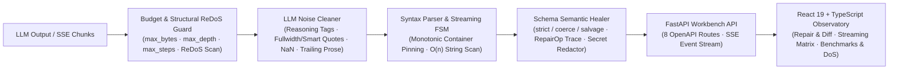
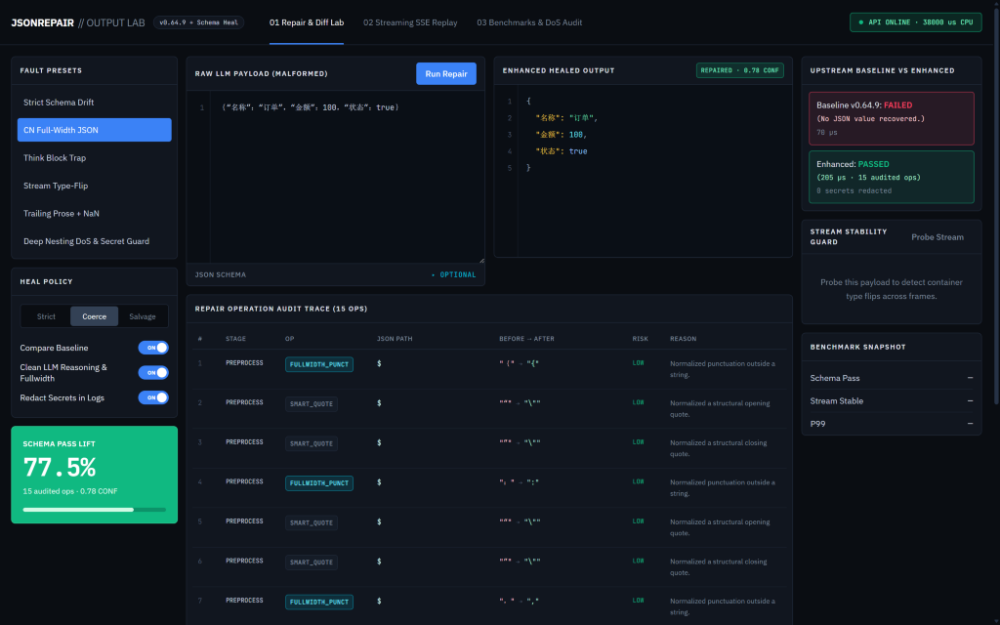
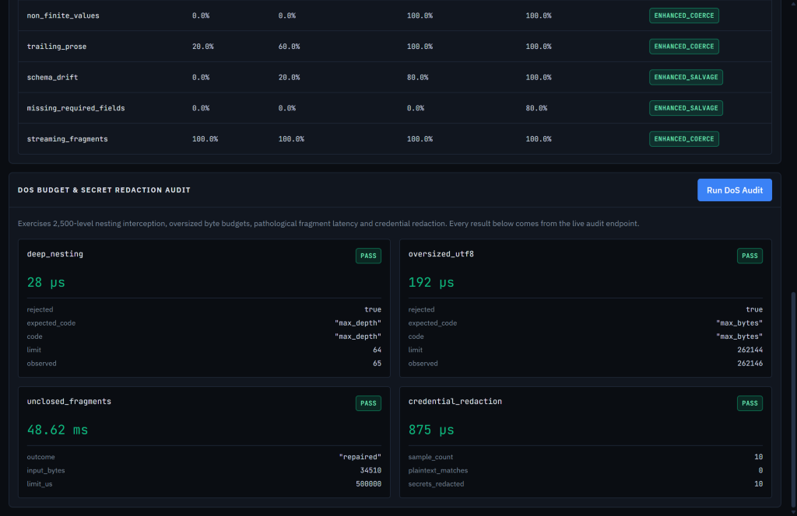

English | [中文](README.zh.md)

# json-repair-lab

**Auditable LLM JSON Repair, Schema-Guided Semantic Healing, Monotonic SSE Streaming & DoS/Redaction Workbench.**

Built as a backward-compatible runtime upgrade and full-stack observability workbench on top of upstream [`mangiucugna/json_repair`](https://github.com/mangiucugna/json_repair) (`v0.64.9`, commit `10d9802`, MIT License). Every optimization is verified on **CPU-only local execution with zero paid LLM APIs**, benchmarked side-by-side against the bundled unmodified `v0.64.9` baseline across **1,676 real JSON Schemas** and **858 function-calling specs**.

---

## Core Capabilities

- **LLM Structural Noise Cleaner (`llm_cleaner.py`)**: Safely strips `<think>` / `<reasoning>` / `<thought>` blocks (ignoring tags inside JSON strings), normalizes CJK full-width structural punctuation & smart quotes outside string literals (`｛“名称”：“订单”｝`), maps bare `NaN` / `Infinity` / `-Infinity` to `null`, and strips trailing natural language prose even when the preceding JSON has syntax damage (`balanced_container_end` fallback).
- **Schema-Guided Semantic Healer (`semantic_heal.py`)**: Opt-in `strict` / `coerce` / `salvage` policies with full field-level `RepairOp` audit trace (`KEY_ALIGN`, `COERCE_INT`/`BOOL`/`FLOAT`/`NULL`, `ENUM_ALIGN`, `PRUNE_EXTRA`, `FILL_DEFAULT`), `required`-key protection, untyped `enum`/`const` literal coercion, and `confidence_score` calculation.
- **Monotonic Streaming Engine (`streaming.py`)**: Incremental state machine with container-type pinning and safe prefix projection (`StreamingJSONRepairer`), plus a stream-aware fix for legacy `stream_stable=True` so partial keys like `{"args": {"q` never flip from `array` (`["q"]`) to `object` (`{}`).
- **DoS Budgets, ReDoS Guard & Credential Redaction (`guard.py`, `validation.py`)**: Pre-flight UTF-8 byte (`256 KiB`), nesting depth (`64`), and parser step (`3M`) budgets; single-pass structural ReDoS-safe regex analyzer; offline `$ref` resolution; and automatic log/trace redaction across 15 credential families (`AKIA`, `LTAI`, `ghp_`, `github_pat_`, `sk-`, `sk-ant-`, Stripe, Slack, GCP/Gemini `AIza`, HuggingFace `hf_`, Bearer, JWT, DB DSNs with `@`-passwords, CN mobile numbers) with 0% benign false positives.
- **11.3x Faster Schema Validation (`schema_repair.py`)**: Content-keyed `lru_cache` validator compilation plus compiled fast-path structural predicate checks (`667.85 μs` → `59.2 μs`), paired with O(n) string scanning in `json_parser.py`.
- **Full-Stack Observability Workbench (`server/` + React 19 UI)**: FastAPI service (8 OpenAPI-contracted REST/SSE endpoints) and three interactive views: **Repair & Diff Lab**, **Streaming SSE Replay**, and **Benchmarks & DoS Audit**.

---

## Architecture



---

## Live Workbench Screenshots

| 01 Repair & Diff Lab (`CN Full-Width JSON` vs Baseline) | 03 Benchmarks & DoS Audit (`40-Case Matrix + 4/4 Security PASS`) |
|---|---|
|  |  |

---

## Verified External Blind Benchmarks

All benchmarks run locally on CPU against the bundled unmodified **`upstream_baseline` (`json_repair` v0.64.9)** without dataset leakage or tuning against sealed test sets.

### 1. Real-World Schema Compatibility (`epfl-dlab/JSONSchemaBench`, `N = 1,676`)

| Subset | Accepted Schemas | Compatibility | Security Guarantee |
|---|---|---|---|
| `Glaiveai2K` | 513 / 513 | **100.0%** | 10 / 10 Adversarial ReDoS Payloads Blocked |
| `Github_easy` | 574 / 577 | **99.5%** | Rejects nested quantifiers (`(a+)+`), quantified alternations (`(a\|aa)+`), lookarounds, backrefs |
| `Github_medium` | 563 / 586 | **96.1%** | Rejects only 26 patterns exceeding complexity safety bounds |
| **Total** | **1,650 / 1,676** | **98.4%** | Up from **84.1%** (1,410 / 1,676) before structural ReDoS analyzer |

### 2. Tier 1: `epfl-dlab/JSONSchemaBench` Multi-Fault Repair (`N = 300`, 7 Compound Fault Classes)

Injected faults: truncated Markdown fences, CJK full-width structural delimiters/quotes, `<think>` draft traps, trailing prose (`{docs}`), broken JSON + trailing prose, `camelCase`/case-enum/extra-key/stringified scalar drift, unquoted keys & trailing commas.

| Mode | Valid JSON Rate | Strict Schema Pass | Field Exact F1 | P95 Latency | P99 Latency |
|---|---|---|---|---|---|
| `json.loads` | 14.0% | 1.7% | 0.0% | 1,453.8 μs | 3,315.4 μs |
| `upstream_baseline` (v0.64.9) | 31.3% | 31.3% | 28.6% | 7,465.8 μs | 15,273.6 μs |
| **`enhanced_coerce`** | **100.0%** | **100.0%** | **99.7%** | **725.5 μs (10.3x↑)** | **1,204.8 μs (12.7x↑)** |
| **`enhanced_salvage`** | **100.0%** | **100.0%** | **99.7%** | **735.5 μs** | **1,261.3 μs** |

### 3. Tier 2: `gorilla-llm/BFCL v3` Tool-Call Repair (`N = 300`) & Streaming Stability (`N = 120`)

Evaluated across `BFCL_v3_simple`, `BFCL_v3_multiple`, and `BFCL_v3_live_simple`:

- **Tool-Calling Argument Repair (`N = 300`)**:

| Mode | Valid JSON Rate | Strict Schema Pass | Field Exact F1 | P95 Latency | P99 Latency |
|---|---|---|---|---|---|
| `json.loads` | 14.0% | 0.0% | 0.0% | 1,291.7 μs | 2,055.7 μs |
| `upstream_baseline` (v0.64.9) | 29.0% | 29.0% | 28.6% | 4,130.4 μs | 5,599.7 μs |
| **`enhanced_coerce`** | **100.0%** | **100.0%** | **99.9%** | **440.6 μs (9.4x↑)** | **513.2 μs (10.9x↑)** |
| **`enhanced_salvage`** | **100.0%** | **100.0%** | **99.9%** | **395.6 μs** | **537.8 μs** |

- **Progressive Chunk-by-Chunk Streaming Stability (`N = 120` BFCL tool calls, `chunk_size = 2`)**:
  - `upstream_baseline (stream_stable=True)`: **120 / 120 (100.0%)** streams experienced container type-flips (`list ↔ dict`, **480 total flips**).
  - **`Enhanced StreamingJSONRepairer`**: **0 / 120 (0.0%)** streams experienced type-flips (**0 total flips**, **120 / 120** exact final reconstruction, median full-stream latency **2,245.1 μs**).

### 4. Tier 3: Built-In 40-Case Matrix, DoS Audit & Sealed OOD Secret Redaction (`N = 30`)

- **Built-In 40-Case Multi-Fault Benchmark (`/api/benchmarks/run`)**:
  - `json_loads`: Schema Pass `17.5%`, Stream Stability `2.5%`, P99 `1,537.5 μs`
  - `upstream_baseline`: Schema Pass `45.0%`, Stream Stability `17.5%`, P99 `1,817.4 μs`
  - `enhanced_coerce`: Valid JSON `100.0%`, Schema Pass `85.0%`, Stream Stability `100.0%`, P99 `338.0 μs`
  - `enhanced_salvage`: Valid JSON `100.0%`, Schema Pass **`97.5%`** (intentionally refuses to fabricate a missing `minLength: 6` required string with no default/example), Field F1 **`100.0%`**, Stream Stability **`100.0%`**, P99 **`255.1 μs`**
- **DoS Budget Audit (`/api/dos/audit`)**: **4 / 4 PASS** (`deep_nesting` `25.8 μs` at depth 65/2500; `oversized_utf8` `138.6 μs`; `unclosed_fragments` `42.95 ms < 500 ms`; `credential_redaction` `746.6 μs`, 0 plaintext leaks).
- **Sealed OOD Secret Redaction (`15` secret families + `15` benign decoys)**: **15 / 15 (100.0%) Recall**, **0 / 15 (0.0%) Benign FPR** (preserves UUID4, SHA256, model names, ISO dates, 13-digit Unix ms, non-mobile 11-digit order IDs, URLs, JSONPaths).
- **Core Parser Micro-Benchmarks**: Cached `SchemaRepairer` valid fast-path median **`59.2 μs`** vs **`667.85 μs`** unmodified upstream (**11.3x speedup**); pathological unclosed comma-fragment string **`1.39 ms`** vs **`10.27 ms`** upstream (**7.4x speedup**).

---

## REST & SSE API Reference

OpenAPI schema contract is versioned at [`后端/docs/openapi.json`](后端/docs/openapi.json) and enforced in CI by [`contract.test.ts`](前端/src/api/__tests__/contract.test.ts).

| Method | Endpoint | Purpose |
|---|---|---|
| `GET` | `/api/health` | Service status, engine capabilities, preset count, uptime |
| `GET` | `/api/presets` | 6 reproducible LLM failure & DoS scenario presets |
| `POST` | `/api/repair` | Repair payload + optional schema healing + optional `v0.64.9` baseline diff + redacted `RepairOp` trace |
| `POST` | `/api/stream/simulate` | Frame-by-frame container flip comparison (`upstream` vs `enhanced`) with `stable_paths` |
| `POST` | `/api/stream/sse` | Live `text/event-stream` SSE delivery emitting `frame` and terminal `done` events |
| `POST` | `/api/schema/validate` | Offline JSON Schema validation without coercion, with credential-redacted error paths |
| `POST` | `/api/benchmarks/run` | Execute 40-case / 8-category multi-engine quality, stability & latency benchmark |
| `POST` | `/api/dos/audit` | Execute live nesting, UTF-8 byte budget, pathological fragment & redaction security checks |

---

## Repository Structure

```text
json-repair-lab/
├── 后端/                         # Python 3.12+ engine, FastAPI workbench & pytest suite
│   ├── src/json_repair/
│   │   ├── guard.py              # Resource budgets & 15-family secret redactor
│   │   ├── llm_cleaner.py        # Reasoning tag, fullwidth/smart-quote, NaN & trailing-prose cleaner
│   │   ├── streaming.py          # StreamingJSONRepairer (monotonic container pinning)
│   │   ├── semantic_heal.py      # strict/coerce/salvage healer + RepairOp audit trail
│   │   ├── validation.py         # Structural ReDoS guard, offline registry & metered validator
│   │   ├── schema_repair.py      # Cached validator & compiled fast-path checks
│   │   └── server/               # FastAPI app, ASGI budget middleware, presets & benchmarks
│   ├── docs/openapi.json         # Synced OpenAPI contract schema
│   └── tests/                    # 670 functional/API/security tests + 25 perf benchmarks
├── 前端/                         # React 19 + TypeScript + Tailwind + Vite observatory
│   └── src/
│       ├── api/                  # Typed fetch/SSE client + OpenAPI contract test suite
│       └── features/             # 01 Repair & Diff Lab · 02 Streaming SSE · 03 Benchmarks & DoS
├── docs/screenshots/             # Live end-to-end verified browser screenshots
├── LICENSE                       # MIT License (upstream + extension copyright)
└── README.md / README.zh.md
```

---

## Quickstart (Local Development)

### Prerequisites
- Python **3.12+** (with `uv` or `pip`)
- Node.js **20+** & `npm`

### 1. Start the Backend API Server (`:8000`)

```bash
cd 后端
uv sync --group dev --extra server
uv run uvicorn json_repair.server.main:app --host 127.0.0.1 --port 8000
```

### 2. Start the Frontend Workbench (`:5173`)

```bash
cd 前端
npm install
npm run dev -- --host 127.0.0.1 --port 5173
```

Open `http://127.0.0.1:5173` in your browser (Vite proxies `/api/*` requests directly to `127.0.0.1:8000`).

---

## Verification & Quality Gates

```bash
# Backend checks (inside 后端/)
ruff check src tests                                  # 0 warnings / 0 errors
mypy src                                              # strict mode: 0 issues across 36 files
pytest -q --ignore=tests/test_performance.py          # 670 passed

# Frontend checks (inside 前端/)
npm run test                                          # 5 test files, 14 passed (incl. OpenAPI contract tests)
npm run build                                         # tsc --noEmit + vite production bundle
```

---

## License & Attribution

Released under the [MIT License](LICENSE). Built upon the upstream [`mangiucugna/json_repair`](https://github.com/mangiucugna/json_repair) parser (`v0.64.9`) by Stefano Baccianella.
