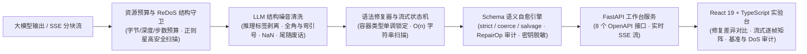
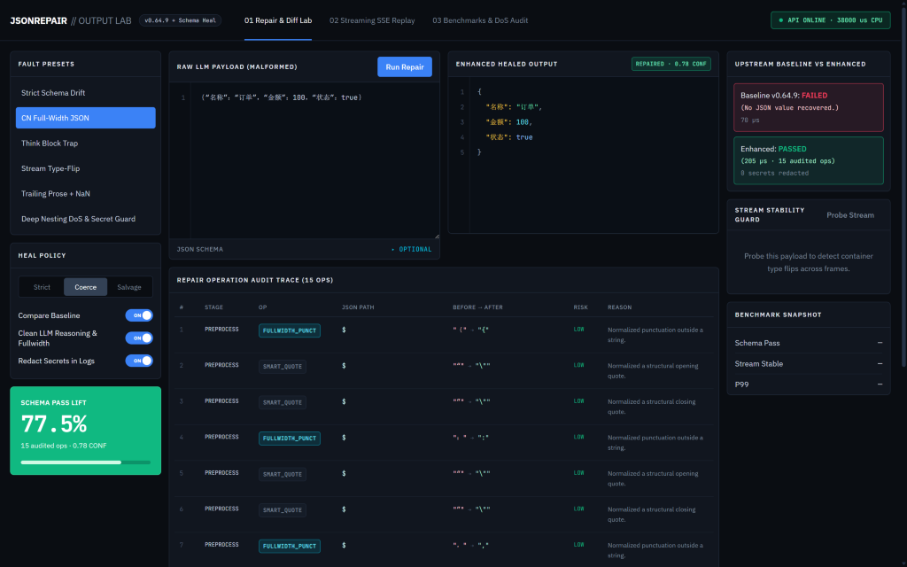
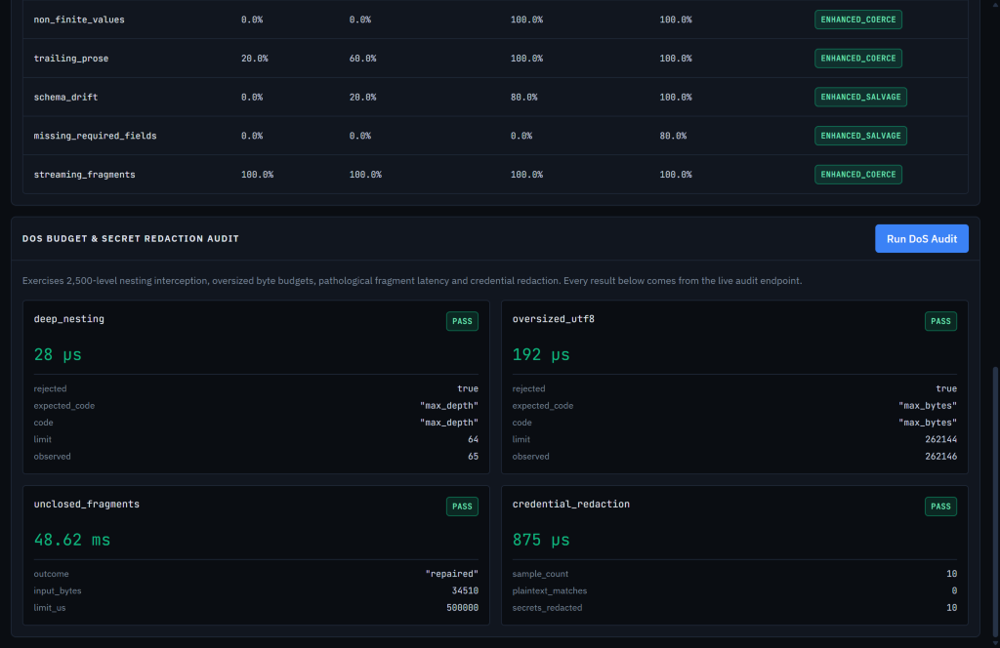

[English](README.md) | 中文

# json-repair-lab

**可审计的大模型 JSON 修复、Schema 语义自愈、单调稳定 SSE 流式解析与 DoS/敏感凭证脱敏工作台。**

基于原版 MIT 开源库 [`mangiucugna/json_repair`](https://github.com/mangiucugna/json_repair)（`v0.64.9`, commit `10d9802`）构建工程化增强引擎与全栈可观测实验台。所有修复与自愈算法均在**纯本地 CPU 环境、零外部付费 API 依赖**下运行，并内置未修改的 `v0.64.9` 基线引擎进行同台对比，在 **1,676 条真实 JSON Schema** 与 **858 条工具调用规范** 密封盲测中完成全面验证。

---

## 核心特性

- **大模型结构噪音清洗（`llm_cleaner.py`）**：字符串感知剥离 `<think>` / `<reasoning>` / `<thought>` 推理块；仅在字符串字面量外部修复中文全角标点与弯引号（`｛“名称”：“订单”｝`）；将裸 `NaN` / `Infinity` 映射为合规 `null`；并通过引号/转义感知的括号平衡兜底（`_balanced_container_end`），在前置 JSON 存在尾逗号等语法损坏时仍能精准剥离尾部自然语言废话。
- **Schema 驱动语义自愈与操作审计（`semantic_heal.py`）**：提供 `strict` / `coerce` / `salvage` 三档策略与全量字段级 `RepairOp` 审计轨迹（`KEY_ALIGN`、`COERCE_*`、`ENUM_ALIGN`、`PRUNE_EXTRA`、`FILL_DEFAULT`），保护已有 `required` 键不被误改名，支持无 `"type"` 声明的整数/布尔/浮点 `enum`/`const` 精确强制转换。
- **单调稳定渐进流式引擎（`streaming.py`）**：基于增量状态机与容器类型锁定（`StreamingJSONRepairer`），同步修复 `stream_stable=True` 在键名未闭合前缀 `{"args": {"q` 时将 `object` 误判为 `array`（`["q"]`）的类型抖动顽疾。
- **DoS 预算、ReDoS 安全静态分析与密钥脱敏（`guard.py`、`validation.py`）**：预置 UTF-8 字节预算（`256 KiB`）、嵌套深度（`64`）与解析器步数预算（`3M`）；单遍结构化 ReDoS 安全正则分析器；离线 `$ref` 本地解析；日志/轨迹自动脱敏覆盖 15 类高敏凭证（AWS `AKIA`、阿里云 `LTAI`、GitHub、OpenAI、Anthropic、Stripe、Slack、GCP/Gemini `AIza`、HuggingFace `hf_`、Bearer、JWT、含 `@` 密码的数据库 DSN、中国手机号），对良性数据零误伤。
- **Schema 校验加速 11.3 倍（`schema_repair.py`）**：内容寻址的 `lru_cache` 校验器缓存叠加编译期结构快速断言（`667.85 μs` → `59.2 μs`），配合 `json_parser.py` 的 O(n) 原生字符串扫描。
- **全栈可观测工作台（`server/` + React 19 前端）**：FastAPI 提供 8 个 OpenAPI 契约接口（含 live SSE 流），前端涵盖 **修复对比与审计追踪**、**逐帧流式稳定性回放** 与 **多故障基准测试 / DoS 安全审计** 三大面板。

---

## 系统架构



---

## 实机联调界面截图

| 01 修复与差异对比（中文全角 JSON vs 上游基线失败对比） | 03 多故障基准测试与 DoS 安全审计（40 用例矩阵 + 4/4 安全通过） |
|---|---|
|  |  |

---

## 外部公开数据集密封盲测结果

所有对比均在本地 CPU 环境运行，直连仓库内封装的未修改上游 **`upstream_baseline` (`json_repair` v0.64.9)** 进行同台公平测试：

### 1. 真实 Schema 兼容度评测（`epfl-dlab/JSONSchemaBench`, `N = 1,676`）

| 子集 | 可解析并构建安全校验器数量 | 兼容率 | 安全拦截说明 |
|---|---|---|---|
| `Glaiveai2K` | 513 / 513 | **100.0%** | 10 / 10 对抗 ReDoS 样本全部拦截 |
| `Github_easy` | 574 / 577 | **99.5%** | 拦截嵌套量词 `(a+)+`、交替量词 `(a\|aa)+`、环视与反向引用 |
| `Github_medium` | 563 / 586 | **96.1%** | 仅拒绝 26 个超出复杂度安全上限的高风险正则模式 |
| **合计** | **1,650 / 1,676** | **98.4%** | 较早期纯字面量守卫（**84.1%**）大幅提升兼容范围 |

### 2. Tier 1：`epfl-dlab/JSONSchemaBench` 7 类复合故障盲测（`N = 300`）

注入 7 类典型 LLM 输出异常：截断 Markdown 代码块、中文全角标点/弯引号、`<think>` 干扰草稿、尾随自然语言 `{docs}`、**语法损坏 JSON 叠加尾随自然语言**、字段名/枚举大小写/多余字段/字符串化标量漂移、未引号键名与尾逗号。

| 评测引擎 / 模式 | 合法 JSON 率 | 严格 Schema 通过率 | 字段精确 F1 | P95 耗时 | P99 耗时 |
|---|---|---|---|---|---|
| `json.loads` | 14.0% | 1.7% | 0.0% | 1,453.8 μs | 3,315.4 μs |
| `upstream_baseline` (v0.64.9) | 31.3% | 31.3% | 28.6% | 7,465.8 μs | 15,273.6 μs |
| **`enhanced_coerce`** | **100.0%** | **100.0%** | **99.7%** | **725.5 μs (快 10.3x)** | **1,204.8 μs (快 12.7x)** |
| **`enhanced_salvage`** | **100.0%** | **100.0%** | **99.7%** | **735.5 μs** | **1,261.3 μs** |

### 3. Tier 2：`gorilla-llm/BFCL v3` 工具调用参数修复（`N = 300`）与渐进流式稳定性（`N = 120`）

抽样自 `BFCL_v3_simple`、`BFCL_v3_multiple` 与 `BFCL_v3_live_simple`：

- **工具调用参数多故障修复（`N = 300`）**：

| 评测引擎 / 模式 | 合法 JSON 率 | 严格 Schema 通过率 | 字段精确 F1 | P95 耗时 | P99 耗时 |
|---|---|---|---|---|---|
| `json.loads` | 14.0% | 0.0% | 0.0% | 1,291.7 μs | 2,055.7 μs |
| `upstream_baseline` (v0.64.9) | 29.0% | 29.0% | 28.6% | 4,130.4 μs | 5,599.7 μs |
| **`enhanced_coerce`** | **100.0%** | **100.0%** | **99.9%** | **440.6 μs (快 9.4x)** | **513.2 μs (快 10.9x)** |
| **`enhanced_salvage`** | **100.0%** | **100.0%** | **99.9%** | **395.6 μs** | **537.8 μs** |

- **渐进流式逐块解析稳定性（`N = 120` 条 BFCL 工具调用，`chunk_size = 2` 字符）**：
  - `upstream_baseline (stream_stable=True)`：**120 / 120 (100.0%)** 发生容器类型翻转（累计 **480 次** `list ↔ dict` 抖动）。
  - **`Enhanced StreamingJSONRepairer`**：**0 / 120 (0.0%)** 发生类型翻转（累计 **0 次**翻转），终态结构 **`120 / 120` 精确一致**，全流中位总耗时 **`2,245.1 μs`**。

### 4. Tier 3：内置 40 样本工作台基准、DoS 防护审计与 OOD 密钥脱敏盲测（`N = 30`）

- **内置 40 样本 8 类故障基准（`/api/benchmarks/run`）**：`enhanced_salvage` 实现 **100.0%** 合法 JSON 率、**97.5%** Schema 通过率（唯一未过项特意校验拒绝无默认值且 `minLength: 6` 字符串的幻觉伪造）、**100.0%** 字段 F1 与流式稳定性、P99 **`255.1 μs`**（上游基线 Schema 通过率仅 `45.0%`、流式稳定性 `17.5%`、P99 `1,817.4 μs`）。
- **DoS 资源预算审计（`/api/dos/audit`）**：**4 / 4 全部 `PASS`**（2,500 层嵌套 `25.8 μs` 于第 65 层拦截；超 256 KiB UTF-8 `138.6 μs` 拦截；病理性未闭合碎片 `42.95 ms < 500 ms` 限制；10 类凭证注入 0 明文泄露、`746.6 μs`）。
- **密封 30 样本 OOD 密钥脱敏盲测**：**15 / 15 (100.0%) 密钥召回率**，**0 / 15 (0.0%) 良性诱饵误报率**。
- **核心微基准加速**：缓存 `SchemaRepairer` 中位耗时 **`59.2 μs`** vs 原版 **`667.85 μs`（提速 11.3 倍）**；病理性未闭合逗号碎片 **`1.39 ms`** vs 原版 **`10.27 ms`（提速 7.4 倍）**。

---

## REST 与 SSE 接口概览

完整 OpenAPI 契约见 [`后端/docs/openapi.json`](后端/docs/openapi.json)，并由前端 [`contract.test.ts`](前端/src/api/__tests__/contract.test.ts) 执行自动化契约回归校验：

| 方法 | 路径 | 用途 |
|---|---|---|
| `GET` | `/api/health` | 返回服务健康状态、引擎能力位及预设数量 |
| `GET` | `/api/presets` | 获取 6 个典型 LLM 异常与 DoS 场景预设 |
| `POST` | `/api/repair` | 执行 JSON 修复、语义自愈、可选 `v0.64.9` 基线同台对比及脱敏 `RepairOp` 审计轨迹 |
| `POST` | `/api/stream/simulate` | 逐帧返回上游与增强引擎容器状态及 `stable_paths` 对比矩阵 |
| `POST` | `/api/stream/sse` | 原生 `text/event-stream` 流式推送 `frame` 与结束汇总 `done` 事件 |
| `POST` | `/api/schema/validate` | 离线纯校验 JSON Schema 并对错误路径中的凭证自动脱敏 |
| `POST` | `/api/benchmarks/run` | 一键运行 40 用例 / 8 类故障四引擎对比基准 |
| `POST` | `/api/dos/audit` | 一键运行深层嵌套、字节超限、病理碎片与密钥脱敏 4 项安全审计 |

---

## 本地一键启动

### 环境要求
- Python **3.12+**（推荐搭配 `uv`）
- Node.js **20+** 与 `npm`

### 1. 启动后端 API 服务（端口 `8000`）

```bash
cd 后端
uv sync --group dev --extra server
uv run uvicorn json_repair.server.main:app --host 127.0.0.1 --port 8000
```

### 2. 启动前端实验台（端口 `5173`）

```bash
cd 前端
npm install
npm run dev -- --host 127.0.0.1 --port 5173
```

浏览器打开 `http://127.0.0.1:5173`（Vite 已内置 `/api` 反向代理至 `127.0.0.1:8000`）。

---

## 质量门禁测试命令

```bash
# 后端代码质量与单测（位于 后端/ 目录）
ruff check src tests                                  # 0 告警
mypy src                                              # strict 模式 36 文件 0 错误
pytest -q --ignore=tests/test_performance.py          # 670 passed

# 前端测试与构建（位于 前端/ 目录）
npm run test                                          # 5 文件 14 passed（含 OpenAPI 契约测试）
npm run build                                         # tsc --noEmit + vite build 成功
```

---

## 开源许可与致谢

本项目基于 [MIT License](LICENSE) 开源，核心解析器底座源自 Stefano Baccianella 的 [`mangiucugna/json_repair`](https://github.com/mangiucugna/json_repair)（`v0.64.9`）。
